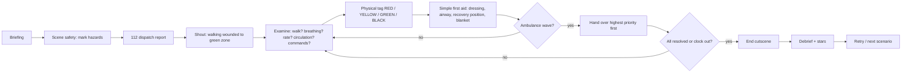
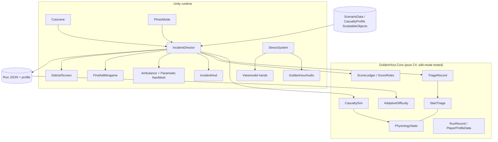

# Golden Hour — Game Design Document (v2)

> **Educational only — not medical training or advice.** The medical content in this game has **NOT been medically reviewed** and should be checked by a qualified first-aid trainer before any teaching use. START triage is described as accurately as we could, and every simplification is marked. Guidelines named here are well-known public references, and each is marked *(verify)*. No citations are invented.

## 1. Vision

Golden Hour is a first-person serious game about the first minutes of a mass-casualty incident. The player is the first trained person on scene. They make it safe, call it in, sort casualties with **START triage**, give simple first aid, and hand people to ambulances in the right order while the "golden hour" clock keeps running.

The game teaches **prioritisation under time pressure**, not clinical skill.

## 2. Pillars

1. **Decisions over dexterity.** Every examination, tag and treatment costs simulated time. The challenge is choosing what to do next.
2. **Honest consequences.** Casualties deteriorate on a seeded physiology model. A wrong first tag, or a delay, can lead to a preventable death that the debrief explains.
3. **Learn by doing, then reflect.** The game uses short scenarios and a detailed debrief (timeline, START step per casualty, heatmap, stars), and invites replay.
4. **Safe and respectful.** No gore, no unsafe procedures, disclaimers everywhere, and simplifications are stated.

## 3. Audience

- Students and first-aid course participants aged 14 and over, school and university serious-games courses, and anyone curious about triage.
- Sessions of 10–20 minutes on a Windows laptop with integrated graphics. Keyboard, mouse or gamepad.

## 4. Core loop

## 5. Mechanics

| Mechanic | Rule |
|---|---|
| Golden-hour clock | 60 simulated minutes. 0.05 sim-min per real second in the tutorial, 0.08 elsewhere. Only the pause menu and photo mode stop it. |
| Examination | Timed actions: check walking, check breathing (open the airway if absent), count the rate, check circulation (capillary refill or radial pulse), give a simple command. Findings are text and never show the answer. |
| START evaluation | Walks → GREEN. Not breathing after airway opening → BLACK. Breathing only after airway opening → RED. Rate > 30 → RED. Refill > 2 s or no radial pulse → RED. Cannot follow commands → RED. Otherwise YELLOW. |
| Tagging | Needs at least one examination. The first tag is scored in full (correct +100, over-triage −20, under-triage −60, wrong BLACK −100). Retagging needs a fresh examination; a justified retag (the condition really changed) earns +40. |
| Deterioration | Each casualty has a death minute and a worsening minute (±5% seeded jitter, scaled by difficulty). Treatments that stabilise stop the timer. A death that the indicated aid would have prevented costs −150. |
| First aid | Hold-to-apply pressure dressing; airway opening; recovery-position roll minigame; blanket (shock delay +4 min); reassurance. Gloves first, or −25 once per casualty. Unneeded treatment −15. Supplies are limited. |
| CPR | Rhythm minigame (100–120/min, 110 bpm metronome). Never scored. The game states that CPR is normally deprioritised in mass-casualty triage. |
| Scene safety | Mark hazards (+20 each). Standing in an unmarked danger zone for 2 s costs −10. |
| Dispatch | 112 report: number, location, casualty count (±1), hazards. +15 per correct field. |
| Ambulances | Timed waves after dispatch. Paramedics walk on a runtime NavMesh and carry casualties on a stretcher. A handover in START-priority order earns +40, out of order −30. |
| Crowd | Shout command (+30) sends walkers to the green zone (auto GREEN). Panicking bystanders can be calmed (+10). |
| Time bonus | 2 points per remaining minute, up to 100, only if the scene is cleared. Accuracy always outweighs speed. |
| Stars | 1 star at 40% of the maximum, 2 at 65%, 3 at 85% with no preventable deaths. |

## 6. Systems

**Adaptive difficulty (documented model).** The game takes the mean of the last three score ratios (score ÷ maximum):

| Mean ratio | Band | Deterioration | Hints |
|---|---|---|---|
| ≥ 0.80 | Challenge | ×1.2 (faster) | Normal |
| ≤ 0.45 | Support | ×0.85 | On |
| Between | Normal | ×1.0 | Normal |

The Easy difficulty setting forces ×0.8 with hints, and the tutorial is always at ×0.8 or below.

## 7. Level design

| Scenario | Setting | Casualties | Teaching focus |
|---|---|---|---|
| Training Yard (tutorial) | Daylight yard, one car | 3 | Guided 8-step tutorial: hazards, gloves, dispatch, shout, examine, tag, dressing, recovery position, handover. |
| Highway Collision | Late afternoon, two-lane road | 6, incl. a helmeted motorcyclist | Traffic, fuel and fire hazards; a casualty who worsens from YELLOW to RED (justified retriage). |
| Night Bus Rollover | Night, rain, coach on its side | 10 | Low visibility, one dressing for two bleeders, an airway death if it is ignored, an expectant passenger. |
| Collapsed Community Hall | Dusty site with rubble | 12, incl. 3 children | Unstable structure, gas and a live wire; a walking-wounded crowd; children (see the JumpSTART note). |

The scenarios unlock in order: one star unlocks the next. Casualty positions are shuffled with a seeded random number generator, except in the tutorial.

## 8. Art and audio direction

- **Art:** stylised low-poly with a warm golden-hour palette, a night blue palette for the bus scenario, and emergency red for the UI.
- **Blender (background mode, script `Blender/generate_v2_assets.py`):** jointed humanoid rigs (adult and child), plus an ambulance, police car, fire engine, overturned bus, motorbike, stretcher and props.
- **Animation:** procedural in Unity. This covers breathing, restless and limp states, walking, sitting, kneeling, recovery roll and stretcher carry. No baked clips are used; see DEV_LOG.
- **Effects and lighting:** fire, sparks, smoke, rain, fog, flashing emergency light bars, and headlight beams at night.
- **Audio:** procedurally generated WAVs (`generate_audio.py`).
  - Effects and ambience: siren, radio static, crowd murmur, heartbeat, breathing, rain, wind, metronome and compression clicks.
  - Music: three layers (pad, pulse, drums) mixed by tension.
  - Sirens, voices and hazards are positioned in 3D.

## 9. Immersion techniques

- First-person view with gloved hands that hold the dressing, blanket or tag, and kneeling to examine.
- Subtle head bob and hand sway, which reduce-motion turns off.
- Stress system: unstable RED casualties, the clock and danger zones drive the heartbeat and breathing audio, a vignette pulse and a hand tremor. It can be toggled off.
- Casualties breathe visibly, move restlessly or go limp, and speak short barks with subtitles.
- Diegetic radio and a casualty tablet; interaction outlines.
- An opening fly-in and an ending orbit cutscene, both skippable.
- F10 photo mode: freezes the clock, hides the HUD, gives a free camera and saves PNGs.

## 10. UX and accessibility

- Main menu over a live 3D scene, with a campaign screen (locks, stars, best scores), loading tips, credits, a feedback questionnaire and pause.
- **Settings:**
  - Graphics presets (Low/Medium/High) and resolution.
  - Key rebinding (new Input System).
  - Subtitles; colour-blind tags with shapes, stripes and priority numbers; text size; reduce motion; stress effects.
  - Master, music and SFX volume; mouse sensitivity.
- Full gamepad support, including UI navigation.

## 11. Learning objectives and assessment

By the end of the campaign a player should be able to:

1. Name the four START categories and the order of the START checks.
2. Explain why scene safety and the emergency call come first.
3. Choose GREEN, YELLOW, RED or BLACK from observations alone.
4. Prioritise handover by triage category.
5. Explain why individual CPR is deprioritised in mass-casualty triage.
6. Recognise that a patient's condition changes, so re-assessment is needed.

**Assessment in-game:** first-tag accuracy, under- and over-triage counts, decision times, preventable deaths, handover order and stars. All are logged in the run JSON.

**Assessment outside the game:** the PLAYTEST_PLAN questionnaire.

## 12. Ethics

- No gore. Injuries are described in neutral text, with simple visual cues (pallor, a stillness, a dressing).
- Death is presented respectfully: the casualty becomes still, the event is logged, and the game does not dwell on it.
- Disclaimers appear in the menu, the How to Play screen, the tutorial briefing, every briefing and every debrief tab.
- Simplifications are marked:
  - Children are triaged with adult START; real practice uses JumpSTART *(verify)*.
  - Timings and deterioration are illustrative.
  - CPR is reduced to rhythm only.
- **Guidelines to check against** *(verify all)*: the START triage system (Newport Beach / Hoag Hospital, 1983); JumpSTART paediatric triage; European Resuscitation Council guidelines on CPR rate; local first-aid organisation guidance (for example Red Cross or St John). 112 is used as the European emergency number *(verify locally)*.
- Telemetry and feedback stay on the player's computer.

## 13. Scope and risks

| Risk | Mitigation |
|---|---|
| Medical inaccuracy | Disclaimers; trainer review required before teaching use; simplifications listed. |
| Too hard or too stressful | Adaptive difficulty, an Easy mode, a tutorial, and a toggle for stress effects. |
| Low-end hardware | Simple meshes, shared materials, limited real-time lights, and a Low preset with reduced render scale. Benchmark harness included. |
| Armature export problems | A jointed empty-hierarchy rig with procedural animation, validated on import. |
| Regressions | 26 edit-mode tests and a 250+ check end-to-end autotest of all four scenarios. |

## 14. Architecture

- **`GoldenHour.Core` assembly:** the simulation, rules, scoring and telemetry in pure C#, with no UnityEngine scene dependencies. It is covered by NUnit edit-mode tests.
- **`IncidentDirector` (partial class):** owns phases and the clock. It is split into `IncidentDirector.cs`, `.Exam.cs` (examination, tags, treatments), `.Panels.cs` (briefing, dispatch, radio, handover, tablet, pause, debrief) and `.FirstAid.cs`.
- **Content:** `ScenarioData` and `CasualtyProfile` ScriptableObjects, created by `GoldenHourContent` in the editor.
- **Editor automation:** `GoldenHourProjectBuilder` (`GoldenHour/Build Project`, `Validate Project`, `Build Windows Player`) builds the scenes, materials and build settings, then validates scenarios, audio, scene references and the imported Blender rigs and vehicles. `V2ModelPostprocessor` bakes the FBX axis conversion.
- **Testing:**
  - `AutomatedPlaytest` (`-goldenhour-autotest <dir>`) plays every scenario end to end with an independent score tally.
  - `PerformanceBenchmark` (`-goldenhour-benchmark <dir>`) measures frame rate.
